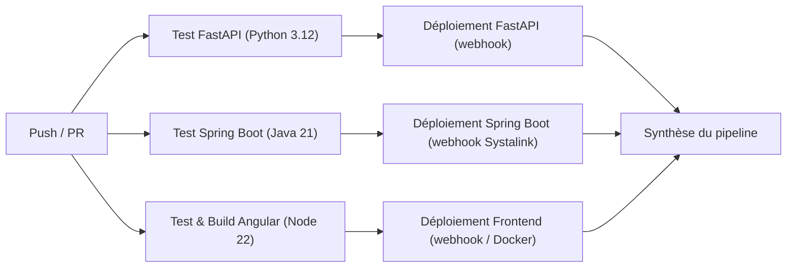

# 🌍 AfriDev Hub — Infrastructure Panafricaine de Réputation, Collaboration & Carrière pour Développeurs

<div align="center">

[](https://spring.io/projects/spring-boot)
[](https://fastapi.tiangolo.com/)
[](https://angular.dev/)
[](https://www.oracle.com/java/)
[](https://www.python.org/)
[](https://www.postgresql.org/)
[](https://redis.io/)
[](https://cloudinary.com/)
[](https://saspay.me/)
[](https://www.docker.com/)
[](https://github.com/HachimouAkram/AfriDev-Hub/actions)

**« Construite par les devs africains, pour les devs africains & l'écosystème tech mondial »**

*Plateforme complète de valorisation du talent tech en Afrique : Réputation vérifiée par les pairs, Moteur de matching IA, Communautés & Groupes avec chat direct, Entraide Tech collaborative, Ressources & Formations monétisées via SasPay, Vitrine de projets avec collaboration Kanban, Hub d'opportunités, Événements tech et Leaderboard panafricain.*

</div>

---

## 📑 Sommaire

1. [🌍 Vision & Ce qu'est AfriDev Hub](#1--vision--ce-quest-afridev-hub)
2. [🏛️ Architecture Système Hybride & Comment c'est Fait](#2-️-architecture-système-hybride--comment-cest-fait)
3. [✨ Ce qui Marche : Panorama Exhaustif des Fonctionnalités](#3--ce-qui-marche--panorama-exhaustif-des-fonctionnalités)
   - [3.1 Authentification Sécurisée & Onboarding Panafricain](#31-authentification-sécurisée--onboarding-panafricain)
   - [3.2 Profils Développeurs & CV Numérique Intégré](#32-profils-développeurs--cv-numérique-intégré)
   - [3.3 Gamification, Niveaux Rééquilibrés & Leaderboard Panafricain](#33-gamification-niveaux-rééquilibrés--leaderboard-panafricain)
   - [3.4 Évaluation Factuelle par les Pairs (Score de Réputation sur 5.0)](#34-évaluation-factuelle-par-les-pairs-score-de-réputation-sur-50)
   - [3.5 Communautés & Groupes Tech avec Chat en Direct](#35-communautés--groupes-tech-avec-chat-en-direct)
   - [3.6 Entraide Tech & Q&A Collaboratif avec Résolution](#36-entraide-tech--qa-collaboratif-avec-résolution)
   - [3.7 Ressources & Formations (Vidéos, Cours & Monétisation SasPay)](#37-ressources--formations-vidéos-cours--monétisation-saspay)
   - [3.8 Vitrine de Projets & Suite Collaborative Kanban](#38-vitrine-de-projets--suite-collaborative-kanban)
   - [3.9 Hub d'Opportunités, Emploi & Gestion des Candidatures](#39-hub-dopportunités-emploi--gestion-des-candidatures)
   - [3.10 Espace Mentorat & Recommandation IA](#310-espace-mentorat--recommandation-ia)
   - [3.11 Portefeuille Numérique (Wallet) & Paiements Multi-Passerelles](#311-portefeuille-numérique-wallet--paiements-multi-passerelles)
   - [3.12 Messagerie Privée & Centre de Notifications](#312-messagerie-privée--centre-de-notifications)
   - [3.13 Cockpit Super Admin, Adoption 54 Pays, Modération & Audit](#313-cockpit-super-admin-adoption-54-pays-modération--audit)
   - [3.14 Espace Entreprises & Classement des Entreprises](#314-espace-entreprises--classement-des-entreprises)
   - [3.15 Événements Tech Panafricains](#315-événements-tech-panafricains)
   - [3.16 Réseau, Abonnements & Suggestions Intelligentes](#316-réseau-abonnements--suggestions-intelligentes)
   - [3.17 Assistant IA AfriDev](#317-assistant-ia-afridev)
   - [3.18 Sécurité du Compte : 2FA, Sessions & Suppression](#318-sécurité-du-compte--2fa-sessions--suppression)
   - [3.19 Expérience Utilisateur : Responsive, Thème Clair/Sombre & Multilingue](#319-expérience-utilisateur--responsive-thème-clairsombre--multilingue)
4. [🧠 Algorithmes & Modèles d'Intelligence Artificielle (FastAPI)](#4--algorithmes--modèles-dintelligence-artificielle-fastapi)
5. [⚙️ Comment ça Marche Sous le Capot (Flux Techniques)](#5-️-comment-ça-marche-sous-le-capot-flux-techniques)
6. [🛠️ Stack Technologique Complète & Matrice des Versions](#6-️-stack-technologique-complète--matrice-des-versions)
7. [🗄️ Modèle de Données Relationnel (PostgreSQL 20+ Entités)](#7-️-modèle-de-données-relationnel-postgresql-20-entités)
8. [🚀 Guide d'Installation & Lancement Pas-à-Pas](#8--guide-dinstallation--lancement-pas-à-pas)
9. [⚙️ Configuration & Variables d'Environnement](#9-️-configuration--variables-denvironnement)
10. [📡 Spécifications des Endpoints de l'API REST (`/api/v1`)](#10--spécifications-des-endpoints-de-lapi-rest-apiv1)
11. [🔒 Sécurité, Confidentialité & OWASP](#11--sécurité-confidentialité--owasp)
12. [🧪 Tests Automatisés & Pipeline CI/CD](#12--tests-automatisés--pipeline-cicd)
13. [☁️ Déploiement en Production](#13-️-déploiement-en-production)
14. [🩺 Dépannage (FAQ Technique)](#14--dépannage-faq-technique)
15. [🤝 Contribution & Conventions](#15--contribution--conventions)

---

## 1. 🌍 Vision & Ce qu'est AfriDev Hub

L'Afrique connaît une dynamique tech exceptionnelle (+21% de développeurs par an), mais les talents du continent se heurtent à plusieurs freins structurels :
1. **Déficit de confiance & méfiance des recruteurs** : les CVs traditionnels sont purement déclaratifs et difficilement vérifiables.
2. **Évaluations de complaisance** : sur les réseaux sociaux classiques, les recommandations reposent sur des affinités personnelles plutôt que sur des collaborations techniques réelles.
3. **Fragmentation continentale** : les communautés de développeurs à Dakar, Lagos, Casablanca, Moroni, Nairobi ou Kigali restent cloisonnées.
4. **Monétisation complexe** : les créateurs de contenu et formateurs éprouvent de réelles difficultés à vendre leurs cours via les moyens de paiement locaux (Mobile Money).

### La Solution AfriDev Hub :
* **Preuve de travail irréfutable** : notation par les pairs verrouillée par une preuve bilatérale (pull request GitHub ou dépôt partagé confirmé).
* **Indice de réputation factuel sur 5.0** pondéré par la crédibilité réelle de l'évaluateur (vérification Mobile Money, complétion de profil).
* **Gamification équilibrée** : ligues de développeurs structurées jusqu'au niveau Expert (fixé à **2 000 XP**).
* **Écosystème communautaire vivant** : groupes avec photos de couverture, modération (bannissement avec motif), chat direct, entraide technique avec attribution automatique de récompenses.
* **Plateforme de formations et monétisation locale** : cours vidéos et articles techniques monétisables via Mobile Money grâce à **SasPay**.
* **Visionneuse de CV PDF native in-app** : consultation instantanée via flux Blob sécurisé sans téléchargement intempestif.
* **Couverture des 54 pays africains** avec adaptation au multilinguisme (Français, Anglais, etc.) et aux modes sombre/clair.

---

## 2. 🏛️ Architecture Système Hybride & Comment c'est Fait

AfriDev Hub repose sur une architecture microservices hybride découplée, alliant la robustesse transactionnelle d'entreprise de **Java / Spring Boot** aux capacités analytiques asynchrones de **Python / FastAPI** et à la réactivité d'un frontend moderne **Angular 18 Standalone** :

```text
┌────────────────────────────────────────────────────────────────────────────────────────┐
│                                 Frontend Client                                        │
│             Angular 18+ (Standalone Components, Signals, RxJS, Responsive PWA)         │
│                 Port: 4200 (Dev) / Port: 3000 (SSR Express Reverse-Proxy)              │
└───────────────────────────────────────────┬────────────────────────────────────────────┘
                                            │ Requêtes HTTP REST + Bearer JWT + WebSocket (STOMP)
                                            ▼
┌────────────────────────────────────────────────────────────────────────────────────────┐
│                                  Backend Core Gateway                                  │
│                              Spring Boot 3.3.4 (Java 21)                               │
│                         Port: 8081 | Context Path: /api/v1                             │
│                                                                                        │
│  - Spring Security (Stateless JWT HS256, Filtres, RBAC)                                │
│  - Modules Métier : Auth, Profils, Groupes, Entraide, Ressources, Projets, Offres, Chat │
│  - WebSocket STOMP Broker : Salons de Chat Groupes & Messagerie Directe                 │
│  - Moteur de Notification & Mails HTML : Brevo SMTP (Port 587)                         │
│  - Passerelle de Paiement & Portefeuille : SasPay Mobile Money, Stripe, UnitechPay     │
│  - Stockage Médias Cloud : Cloudinary API (Avatars, Couvertures, CV PDF, Preuves)     │
└───────────────────────┬───────────────────────────────┬────────────────────────────────┘
                        │                               │
       Appels HTTP REST │                               │ Requêtes JPA / Hibernate
       (Analytique & IA)│                               │ (Pool HikariCP)
                        ▼                               ▼
┌─────────────────────────────────┐   ┌──────────────────────────────────────────────────┐
│  Service IA & Analytics FastAPI │   │         Bases de Données & Caches                │
│      Python 3.12 (Port 8000)    │   │                                                  │
│                                 │   │  🐘 PostgreSQL 16 (Port 15432)                   │
│ - Scraping & Agrégation GitHub  │   │     Persistance relationnelle ACID (20+ entités) │
│ - Algorithme Score Réputation   │   │     Indexation full-text, géolocalisation & tags │
│ - Algorithme de Matching Réseau │   │                                                  │
│   (Jaccard + Synergie + Géo)    │   │  ⚡ Redis 7 (Port 6380)                          │
│ - Assistant IA Communautaire    │   │     Cache contributions GitHub (TTL 24h),        │
│ - Matching Mentors              │   │     Codes OTP de connexion (TTL 10 min),         │
│                                 │   │     Cache analytics admin (10-15 min),           │
└───────────────┬─────────────────┘   │     Cache leaderboard, réseau & projets          │
                │                     └──────────────────────────────────────────────────┘
                │ Cache Read / Write                    ▲
                └───────────────────────────────────────┘
```

---

## 3. ✨ Ce qui Marche : Panorama Exhaustif des Fonctionnalités

### 3.1 Authentification Sécurisée & Onboarding Panafricain
* **Inscription & Connexion Email/Mot de passe** : hachage BCrypt fort avec politique de complexité.
* **Prise en charge des 54 pays africains** : sélection par drapeau et nom de pays avec indicatif téléphonique et géolocalisation.
* **Choix du Rôle dès l'inscription** : `DEVELOPER` (développeur / apprenant) ou `RECRUITER` (recruteur / entreprise).
* **Authentification sans mot de passe par code OTP (Email)** : génération de codes temporaires à 6 chiffres envoyés par email via **Brevo SMTP**, sécurisés en cache **Redis** avec TTL de 10 minutes.
* **Connexion en 1 clic Google OAuth 2.0** : intégration du SDK Google Identity Services.
* **Traçabilité des connexions** : journalisation de chaque session dans `login_sessions` (adresse IP, User-Agent, horodatage).

### 3.2 Profils Développeurs & CV Numérique Intégré
* **Profil Technique Riche** : biographie, compétences sous forme de tags interactifs, disponibilité (Temps plein, Freelance, En poste), salaire/TJM souhaité et liens sociaux (GitHub, LinkedIn, Portfolio).
* **Synchronisation GitHub Temps Réel** : interrogation automatique des dépôts publics, extraction du volume de commits, cumul des étoiles et analyse de la répartition des langages via FastAPI avec mise en cache Redis 24h.
* **Gestion & Téléversement de CV PDF** :
  * Upload sécurisé sur Cloudinary en tant que document brut (`resource_type: raw`).
  * Stockage persistant de l'URL du document dans le profil du développeur.
* **Visionneuse de CV Native In-App** :
  * Clic sur **« Voir mon CV »** ou sur la carte CV : affichage immédiat dans un **modal responsive in-app** sans quitter la plateforme.
  * Exploitation d'un flux **Blob natif** (`application/pdf`) évitant les téléchargements intempestifs et contournant les restrictions de serveurs distants.
  * Commandes intégrées : **Plein écran** dans un nouvel onglet et bouton de **Téléchargement direct**.
  * Affichage clair pour les tiers et recruteurs lorsque le candidat n'a pas encore téléversé son CV.
* **Badge de Vérification Mobile Money** : certification de confiance attestant de l'identité vérifiée du développeur.
* **Jauge Dynamique de Complétion de Profil** : calcul réactif du taux de complétion (0 à 100%) encourageant l'enrichissement des données.

### 3.3 Gamification, Niveaux Rééquilibrés & Leaderboard Panafricain
* **Nouveau Barème d'XP Rééquilibré** :

| Échelon | Niveau | Badge | Intervalle XP | Rôle & Réputation |
| :---: | :--- | :---: | :---: | :--- |
| **1** | **Junior** | 🟢 | **0 – 499 XP** | Apprenant & Développeur junior en montée en compétences |
| **2** | **Senior** | 🔵 | **500 – 1 999 XP** | Développeur confirmé, contributions actives et collaborations régulières |
| **3** | **Expert** | 🟣 | **2 000 – 3 999 XP** | Développeur d'élite, haute réputation, mentorat et projets majeurs |
| **4** | **Tech Lead** | 🟠 | **4 000 – 6 999 XP** | Pilier technique, leadership d'équipe et formations reconnues |
| **5** | **Leader** | 👑 | **7 000+ XP** | Figure incontournable de l'écosystème tech continental |

* **Règles d'Attribution d'XP Précises & Factuelles** :
  * Publication d'un projet tech : `+50 XP`
  * Publication d'une ressource ou vidéo de formation : `+20 XP` (automatique, non manipulable par l'utilisateur)
  * Consultation unique d'une formation par un développeur : `+1 XP` attribué au créateur
  * Réalisation d'une tâche Kanban dans un projet : `+20 XP`
  * Réception d'une reconnaissance (upvote) sur un projet : `+15 XP`
  * Évaluation certifiée par les pairs : `+30 à +50 XP` pour la personne évaluée / `+15 XP` pour l'évaluateur
  * Collaboration complète finalisée : `+100 XP`
* **Classement Panafricain (Leaderboard)** :
  * Filtre à l'échelle du continent ou filtrable individuellement par pays (Top Sénégal, Top Côte d'Ivoire, Top Comores, Top Nigéria, Top Maroc, etc.).
  * Synchronisation d'état réactive : aucune nécessité de se déconnecter/reconnecter pour constater l'actualisation de ses points d'XP.

### 3.4 Évaluation Factuelle par les Pairs (Score de Réputation sur 5.0)
* **Verrou de Sécurité Anti-Fraude** : impossible de noter un développeur sans preuve d'une collaboration préalable.
* **Processus en 3 étapes** :
  1. *Déclaration de collaboration* : indication du type (Open Source, Freelance, Entreprise) et lien de preuve (PR GitHub, commit, dépôt commun).
  2. *Validation bilatérale* : le pair reçoit une notification et doit obligatoirement valider l'existence de la collaboration.
  3. *Notation multicritères* : notation de 1 à 5 étoiles sur 4 dimensions d'ingénierie :
     * Qualité du code (lisibilité, tests, architecture)
     * Profondeur technique (résolution de problèmes complexes)
     * Fiabilité & Respect des délais
     * Communication & Esprit d'équipe
* **Calcul automatique du Score de Réputation** consolidé par FastAPI et pondéré par la crédibilité propre de l'évaluateur.

### 3.5 Communautés & Groupes Tech avec Chat en Direct
* **Création & Gestion de Groupes** : espaces dédiés par techno (ex: *DevOps Africa*, *Flutter Comores*, *Spring & Angular Africa*) ou par pôle régional.
* **Personnalisation Visuelle Complète** : téléversement d'une **photo de couverture de groupe** et d'un logo hébergés sur Cloudinary.
* **Modération Avancée pour l'Administrateur** :
  * Approbation et refus des demandes d'adhésion.
  * Gestion des rôles : `OWNER`, `ADMIN`, `MEMBER`.
  * **Option de bannissement avec motif obligatoire** pour écarter les comportements inappropriés.
  * Possibilité de lever un bannissement ultérieurement.
  * Modification des métadonnées du groupe ou suppression définitive par l'administrateur.
* **Salons de Chat Textuels en Direct** : communication instantanée via WebSocket STOMP avec historique de messages persisté en base de données.
* **Fils de Discussion & Publications** : partage de messages, d'articles et d'annonces au sein du groupe avec système de commentaires.

### 3.6 Entraide Tech & Q&A Collaboratif avec Résolution
* **Publication de Demandes d'Aide** : formulaire optimisé avec saisie libre multi-technologies (tags interactifs / chips sans liste déroulante restrictive).
* **Cycle de Vie Automatisé** :
  * `Ouverte` : demande publiée en attente de conseils.
  * `En cours` : échanges et réponses en cours par les membres.
  * `Résolue` : l'auteur valide la meilleure réponse et clôture la demande.
* **Discussion Directe Instantanée** : bouton permettant d'ouvrir un modal de messagerie directe avec l'auteur pour lui apporter une solution personnalisée.
* **Reconnaissance de l'Aidant** : attribution de points d'XP et valorisation publique de l'entraide communautaire.

### 3.7 Ressources & Formations (Vidéos, Cours & Monétisation SasPay)
* **Catalogue de Ressources d'Apprentissage** : tutoriels, cours vidéos (intégration YouTube native sans rupture d'iframe), articles techniques et documentations PDF.
* **Modal de Publication Responsive** :
  * Saisie multi-technologies par tags.
  * Choix du type de contenu, de la langue et du niveau requis.
  * Calcul automatique et sécurisé des XP : `+20 XP` à la création et `+1 XP` par consultation unique (champ arbitraire masqué à l'utilisateur pour garantir l'intégrité).
* **Espace Dédié « Mes Ressources & Formations »** :
  * Interface dédiée aux formateurs pour gérer leur catalogue.
  * Possibilité de créer, éditer les détails ou supprimer leurs publications.
* **Monétisation via SasPay Mobile Money** : vente de formations avec paiement direct en monnaie locale et crédit automatique sur le portefeuille (Wallet) du formateur.

### 3.8 Vitrine de Projets & Suite Collaborative Kanban
* **Showcase de Réalisations Tech** : présentation de solutions complètes (SaaS, applications mobiles, plateformes web, librairies open source).
* **Reconnaissances Uniques (Upvotes)** : système de vote valorisant le travail bien fait avec protection contre les votes multiples.
* **Espace d'Équipe & Recrutement d'Équipiers** : les fondateurs de projets peuvent ouvrir des rôles et accepter des candidatures.
* **Tableau Kanban Intégré** :
  * Gestion des colonnes *À faire*, *En cours*, *Terminé*.
  * Attribution de priorités (`LOW`, `MEDIUM`, `HIGH`, `URGENT`).
  * Assignation des tâches aux membres de l'équipe et gain d'XP à la livraison.

### 3.9 Hub d'Opportunités, Emploi & Gestion des Candidatures
* **Offres Panafricaines & Internationales** : CDI, CDD, Freelance / Télétravail, Stages et Missions Open Source rémunérées.
* **Publication In-App d'Opportunités** : modal accessible directement depuis le tableau de bord recruteur sans redirection forcée vers le site public.
* **Candidature en 1 Clic** : le candidat postule instantanément en rattachant son profil AfriDev Hub, sa lettre et son CV PDF.
* **Espace Recruteur Dédié** :
  * Consultation de la liste des candidats par offre.
  * Visionnage direct du CV et du score de réputation certifié.
  * Gestion du statut de candidature (`PENDING`, `REVIEWING`, `ACCEPTED`, `REJECTED`) avec notification automatique par email.

### 3.10 Espace Mentorat & Recommandation IA
* **Annuaire des Mentors Tech** : développeurs expérimentés et Tech Leads prêts à accompagner des juniors.
* **Appariement Intelligent par IA** : algorithme d'affinité croisant technologies maîtrisées, pays et objectifs de carrière.
* **Demandes de Mentorat & Évaluations** : suivi des séances d'accompagnement et validation des progrès.

### 3.11 Portefeuille Numérique (Wallet) & Paiements Multi-Passerelles
* **Système de Solde Développeur / Formateur** : gestion des devises africaines (KMF, XOF, etc.) pour stocker les revenus générés par les formations ou la vente de projets.
* **Passerelle SasPay Mobile Money** : initiation de paiement via USSD / Push Mobile Money adapté aux Comores et aux pays de la zone CEMAC / UEMOA.
* **Passerelles Alternatives** : Stripe (cartes internationales) et UnitechPay.
* **Demandes de Retrait (Payouts / Withdrawals)** : virement vers compte bancaire ou numéro Mobile Money avec validation par l'administration.

### 3.12 Messagerie Privée & Centre de Notifications
* **Discussions Directes (1-to-1)** : canal de communication fluide entre développeurs et avec les recruteurs.
* **Centre de Notifications Global** : alertes en temps réel sur les interactions clés (nouveau message, demande d'évaluation, vote sur un projet, statut de candidature).

### 3.13 Cockpit Super Admin, Adoption 54 Pays, Modération & Audit
Espace réservé aux rôles `ADMIN` et `SUPER_ADMIN` (route Angular `/admin`, API `/api/v1/admin/**`).

| Page | Contenu |
| :--- | :--- |
| **Tableau de bord** (`/admin/overview`) | KPIs globaux (talents, entreprises, offres, candidatures, formations, groupes, projets, événements), courbe spline multi-séries des tendances mensuelles, barres groupées comparatives, anneau de répartition de l'écosystème (6 composantes, légende 3×2), derniers événements d'audit. |
| **Adoption** (`/admin/adoption`) | Classement multi-piliers des pays (talents, entreprises, offres, formations, groupes, projets), score de performance continental normalisé sur 100, niveau de vitalité (*Élite Panafricaine*, *Moteur Régional*, *En Forte Croissance*, *Hub Émergent*), drapeaux officiels, filtres par pilier et recherche par pays. Tableau à défilement horizontal sur desktop, cartes empilées sur mobile. |
| **Utilisateurs** (`/admin/users`) | Recherche paginée (nom, pays, rôle, statut), fiche détaillée, suspension / bannissement / réactivation avec motif et email automatique. |
| **Modération** (`/admin/moderation`) | Traitement des signalements (`PENDING`, `RESOLVED`, `DISMISSED`), masquage / republication / suppression de projets avec notification de l'auteur. |
| **Audit** (`/admin/audit`) | Journal immuable `audit_logs` : opérateur, action, ressource, métadonnées JSON, IP, horodatage UTC. |

* **Pouvoirs exclusifs du Super Admin** :
  * Création de comptes `ADMIN` / `SUPER_ADMIN` avec **mot de passe temporaire fort** généré automatiquement et envoyé par email ; changement de mot de passe **obligatoire** à la première connexion (`/auth/change-initial-password`).
  * **Suppression définitive** d'un compte avec effacement en cascade (projets, offres, candidatures, formations, commentaires…) et trace préalable dans l'audit.
* **Chargement instantané** : les statistiques sont mises en cache côté serveur (Redis) et côté navigateur ; les pages s'affichent immédiatement puis se rafraîchissent en arrière-plan. Toute action administrative invalide automatiquement les données concernées.
* **Compatibilité totale mode clair / mode sombre** sur toutes les pages d'administration.

### 3.14 Espace Entreprises & Classement des Entreprises
* **Fiche entreprise publique** (`/entreprise/:slug`) : logo, description, pays, offres publiées, statut de vérification.
* **Espace Recruteur** (`/recruiter`) : offres, candidatures reçues, événements, formations, **gestion d'équipe** (ajout / retrait de membres par le propriétaire) et **journal d'activité** de l'entreprise.
* **Vérification par l'administration** (`PATCH /companies/{id}/admin-status`).
* **Classement des entreprises** (`/classement/entreprises`) : palmarès des entreprises les plus actives de l'écosystème.

### 3.15 Événements Tech Panafricains
* Publication de hackathons, meetups, conférences et webinaires (présentiel ou en ligne).
* Votes d'intérêt, espace « Mes événements », édition et suppression par l'organisateur.
* Suggestions d'événements personnalisées selon les compétences et le pays.

### 3.16 Réseau, Abonnements & Suggestions Intelligentes
* **Annuaire réseau** (`/network`) filtrable par pays, compétences et rôle.
* **Abonnements (Follow)** : suivre un développeur ou un recruteur, listes d'abonnés / abonnements et statistiques.
* **Suggestions de connexions** calculées par le moteur FastAPI (Jaccard + synergie des rôles + réputation + proximité géographique, voir §4.B), avec explication du score.

### 3.17 Assistant IA AfriDev
Page dédiée (`/ai-assistant`) et services intégrés dans la plateforme :
* **Audit de projet** (qualité, stack, pistes d'amélioration) et **génération de pitch**.
* **Traduction** de contenus techniques (FR ⇄ EN…).
* **Simulation d'entretien technique** et **matching candidat ⇄ offre**.
* **Résumé** de discussions, **extraction automatique de tags**, **recommandation de groupes** et **modération automatique** de contenu.
* **Chat conversationnel** d'assistance aux développeurs.

### 3.18 Sécurité du Compte : 2FA, Sessions & Suppression
* **Double authentification (2FA)** activable depuis le profil, vérifiée à la connexion (`/auth/login/verify-2fa`).
* **Gestion des sessions actives** : liste des appareils connectés, révocation d'une session ou de toutes les autres.
* **Connexion GitHub OAuth** en plus de Google et de l'OTP email.
* **Suppression de compte en libre-service** avec **aperçu de l'impact** (`/profiles/me/deletion-impact`) avant confirmation.

### 3.19 Expérience Utilisateur : Responsive, Thème Clair/Sombre & Multilingue
* **Responsive intégral** (mobile, tablette, desktop, grands écrans) : tableaux à défilement horizontal, cartes empilées sur mobile, modales de publication adaptatives (projets, formations, offres).
* **Thème clair / sombre** commutable depuis la barre supérieure, avec contrastes vérifiés sur l'ensemble des pages (public, tableau de bord, administration).
* **Sélecteur de langue** (FR / EN) et **drapeaux officiels** des 54 pays africains.
* **Page d'accueil cinématique** : vidéo holographique de l'Afrique en arrière-plan, vitesse pilotée par le défilement, animations d'entrée.

---

## 4. 🧠 Algorithmes & Modèles d'Intelligence Artificielle (FastAPI)

Le microservice FastAPI (`backend-fastapi`) prend en charge la totalité des calculs mathématiques et heuristiques afin de garantir des temps de réponse inférieurs à 50ms sur le backend principal.

### A. Algorithme du Score de Réputation Factuel (Sur 5.0)
Le score de réputation $S_{\text{global}}$ est calculé par une combinaison linéaire pondérée des 4 dimensions d'ingénierie :

$$S_{\text{global}} = (0.30 \times C_{\text{code}}) + (0.30 \times P_{\text{tech}}) + (0.20 \times F_{\text{fiabilité}}) + (0.20 \times K_{\text{collab}})$$

**Pondération de l'Évaluateur ($W_{\text{eval}}$) :**
Pour neutraliser les fermes à clics et comptes fictifs, chaque avis est multiplié par le coefficient de crédibilité de son évaluateur :

$$W_{\text{eval}} = \left(1.0 + 0.25 \times \mathbb{I}_{\text{MobileMoneyVerified}}\right) \times \max\left(0.5, \frac{\text{ProfileCompletionScore}}{100}\right)$$

### B. Algorithme de Matching Réseau & Recommandation
Le moteur d'appariement (`/api/v1/suggestions/network`) analyse les profils candidats et attribue un score sur 100 points :

1. **Similarité de Compétences (Indice de Jaccard - Max 40 pts)** :
   $$J(A, B) = \frac{|A \cap B|}{|A \cup B|} \times 40$$
2. **Synergie des Rôles (Max 30 pts)** :
   * Recruteur $\leftrightarrow$ Développeur : `30 pts` (Appariement optimal offre/demande)
   * Développeur $\leftrightarrow$ Recruteur : `25 pts`
   * Développeur $\leftrightarrow$ Développeur : `20 pts` (Synergie de collaboration technique)
3. **Réputation Certifiée par les Pairs (Max 20 pts)** :
   $$\text{Pts}_{\text{rep}} = \frac{\min(Score, 5.0)}{5.0} \times 20$$
4. **Proximité Géographique Panafricaine (Max 10 pts)** :
   * Même pays africain : `+7 pts`
   * Même ville : `+3 pts` supplémentaires
5. **Score final** : Borné entre 35% et 99% avec explications dynamiques fournies à l'utilisateur (*ex: "Compétences communes : Spring Boot, Angular", "Réputation certifiée 4.9/5", "Synergie Recruteur - Développeur"*).

---

## 5. ⚙️ Comment ça Marche Sous le Capot (Flux Techniques)

### Flux 1 : Consultation Sécurisée du CV en Visionneuse Native
```text
Utilisateur / Recruteur ──[ Clic sur "Voir mon CV" ]──► ProfileDetailComponent
                                                              │
                                            Appel getCvBlob() │ HTTP GET (CORS *)
                                                              ▼
                                                   Cloudinary CDN Storage
                                                              │
                                     Flux binaire %PDF-1.7    ▼
ProfileDetailComponent ◄──[ URL.createObjectURL(blob) ]── ProfileService
        │
        ├──► Affichage instantané dans l'iframe modale in-app
        ├──► Bouton "Plein écran" (ouvre l'URL blob dans un onglet dédié)
        └──► Bouton "Télécharger" (téléchargement direct avec nom propre)
```

### Flux 2 : Publication d'une Ressource & Attribution Logique d'XP
```text
Développeur ──[ Formulaire Publication Ressource ]──► ResourceController (Spring Boot)
                                                              │
                     Validation DTO (Type, Lien, Tags)        ▼
                                                       ResourceService
                                                              │
                                    ┌─────────────────────────┴─────────────────────────┐
                                    ▼                                                   ▼
                         Sauvegarde ResourceEntity                              Appel XpService
                         (BDD PostgreSQL)                                       (+20 XP immédiats)
                                                                                        │
                                                                                        ▼
                                                                             Création XpTransaction
                                                                             Mise à jour DeveloperLevel
```

### Flux 3 : Chat en Direct dans un Groupe Tech (WebSocket STOMP)
```text
Membre du Groupe ──[ Message textuel ]──► WebSocket Endpoint /ws/group-chat
                                                    │
                                     Broker STOMP   ▼
                                         GroupChatController
                                                    │
                     ┌──────────────────────────────┴──────────────────────────────┐
                     ▼                                                             ▼
         Persistance en BDD                                    Diffusion temps réel
         (GroupChatMessageEntity)                              Topic /topic/group.{groupId}
                                                                                   │
                                                                                   ▼
                                                                    Tous les membres connectés
                                                                    au salon reçoivent le message
```

---

## 6. 🛠️ Stack Technologique Complète & Matrice des Versions

| Rôle | Composant | Version | Justification Technique |
| :--- | :--- | :---: | :--- |
| **Frontend Web** | Angular | `18.2+` | Architecture moderne Standalone, Signals réactifs, RxJS, PWA-ready, zéro dépendance UI externe lourde. |
| **Serveur SSR / Proxy** | Node.js / Express | `20+` | Reverse-proxy des requêtes `/api/*` et routage optimisé. |
| **Backend Core** | Spring Boot | `3.3.4` | Java 21, Spring Security Stateless, Spring Data JPA, Hibernate, WebSocket STOMP. |
| **Microservice IA** | FastAPI | `0.110+` | Python 3.12, Uvicorn asynchrone, Pydantic v2, HTTPX, algorithmes de Jaccard et réputation. |
| **Base Relationnelle** | PostgreSQL | `16-alpine` | Intégrité ACID, 20+ tables relationnelles, indexation full-text et géolocalisation. |
| **Cache & Sessions** | Redis | `7-alpine` | Cache contributions GitHub (TTL 24h), stockage sécurisé des codes OTP email. |
| **Stockage Médias & Documents** | Cloudinary | `1.39+` | Hébergement sécurisé des avatars, couvertures de groupes et documents PDF bruts. |
| **Service Email Transactionnel** | Brevo SMTP | `Port 587` | Envoi d'emails transactionnels HTML (codes OTP, alertes de candidatures). |
| **Passerelles de Paiement** | SasPay / Stripe | `v1` | SasPay pour Mobile Money (Comores / Afrique), Stripe pour cartes bancaires internationales. |
| **Conteneurs & Déploiement** | Docker & Compose | `v2+` | Déploiement automatisé en une seule commande de l'infrastructure de données. |
| **Intégration Continue** | GitHub Actions | `v4` | Tests FastAPI (Pytest), Spring Boot (JUnit 5 / Mockito), Angular (Node 22) puis déploiement automatique. |
| **Tests Backend** | JUnit 5 / Mockito | `5.x` | Tests unitaires des services métier (admin, auth, profils, groupes, entraide, leaderboard…). |

---

## 7. 🗄️ Modèle de Données Relationnel (PostgreSQL 20+ Entités)

Le schéma relationnel garantit une stricte intégrité référentielle :

```text
┌─────────────────┐       1:1       ┌──────────────────┐       1:1       ┌──────────────────┐
│   users         ├─────────────────┤  profiles        ├─────────────────┤  wallets         │
│  - email        │                 │ - country (54)   │                 │ - balance        │
│  - password     │                 │ - cv_url, github │                 │ - currency (KMF) │
│  - role, level  │                 │ - xp, rep_score  │                 └────────┬─────────┘
└────────┬────────┘                 └────────┬─────────┘                          │ 1:N
         │                                   │                                    ▼
         ├─────────────────┐                 ├──────────────────────────┐  ┌──────────────────┐
         │ 1:N             │ 1:N             │ 1:N                      │  │ wallet_tx        │
         ▼                 ▼                 ▼                          │  │ - type, amount   │
┌──────────────────┐ ┌─────────────┐ ┌───────────────────┐              │  └──────────────────┘
│  projects        │ │ login_sess  │ │  collaborations   │              │
│ - title, tags    │ └─────────────┘ │ - proof_url       │◄────────┐    │ 1:N
│ - repo, demo     │                 │ - is_verified     │         │    ▼
└────────┬─────────┘                 └───────────────────┘         │  ┌──────────────────┐
         │                                                         │  │ xp_transactions  │
         ├───────────────────┬───────────────────┐                 │  │ - amount, source │
         │ 1:N               │ 1:N               │ 1:N             │  └──────────────────┘
         ▼                   ▼                   ▼                 │
┌──────────────────┐ ┌─────────────────┐ ┌──────────────────┐      │
│ project_members  │ │ project_tasks   │ │  evaluations     ├──────┘ (Verrou anti-fraude)
│ - member_status  │ │ - kanban_column │ │ - 4 critères     │
│ - role_in_team   │ │ - priority, xp  │ │ - score_total    │
└──────────────────┘ └─────────────────┘ └──────────────────┘

┌──────────────────┐ 1:N             ┌──────────────────┐ 1:N       ┌──────────────────┐
│  groups          ├─────────────────┤ group_members    ├───────────┤ group_bans       │
│ - name, cover_url│                 │ - role, status   │           │ - reason, date   │
└────────┬─────────┘                 └──────────────────┘           └──────────────────┘
         │ 1:N
         ├───────────────────────────────────────┐
         ▼                                       ▼
┌──────────────────┐                   ┌──────────────────┐
│ group_posts      │                   │ group_channels   │──► group_chat_messages (1:N)
│ - text, media_url│                   │ - type (GENERAL) │
└──────────────────┘                   └──────────────────┘

┌──────────────────┐ 1:N             ┌──────────────────┐ 1:N       ┌──────────────────┐
│ opportunities    ├─────────────────┤ applications     ├───────────┤ resources        │
│ - title, type    │                 │ - cv_url, status │           │ - title, xp, url │
└──────────────────┘                 └──────────────────┘           └──────────────────┘

┌──────────────────┐ 1:N             ┌──────────────────┐
│ help_posts       ├─────────────────┤ help_comments    │
│ - tech_tags, stat│                 │ - is_solution    │
└──────────────────┘                 └──────────────────┘
```

---

## 8. 🚀 Guide d'Installation & Lancement Pas-à-Pas

### Structure du Dépôt
```text
AfriDev-Hub/
├── backend-spring/            # API principale Spring Boot 3.3 (Java 21) — port 8081, contexte /api/v1
│   ├── src/main/java/africa/afridev/
│   │   ├── config/            # Sécurité, CORS, WebSocket, Redis, DataInitializer (données de démo)
│   │   ├── controller/        # 30 contrôleurs REST (auth, admin, profils, projets, groupes, paiements…)
│   │   ├── dto/               # Objets de transfert (requêtes / réponses)
│   │   ├── model/             # Entités JPA & énumérations (Role, UserStatus, ContentStatus…)
│   │   ├── repository/        # Spring Data JPA
│   │   └── service/           # Logique métier (AdminService, AuthService, RedisCacheService…)
│   └── src/test/java/         # Tests JUnit 5 / Mockito
├── backend-fastapi/           # Microservice IA & analytics (Python 3.12) — port 8000
│   ├── app/routers/           # github, reputation, suggestions, mentors, ai_community
│   ├── app/services/          # Algorithmes (réputation, matching, IA communautaire…)
│   └── tests/                 # Pytest
├── frontend-angular/          # Application web Angular 18 (standalone + signals)
│   ├── src/app/core/          # Services, guards, interceptors
│   ├── src/app/features/      # admin, auth, dashboard, projects, groups, help, resources, events…
│   ├── server.js              # Serveur Node de production + reverse-proxy /api → Spring Boot
│   └── proxy.conf.json        # Proxy de développement (ng serve)
├── docker/                    # init.sql, nginx.conf, scripts d'entrée
├── .github/workflows/         # Pipeline CI/CD (ci-tests.yml)
├── docker-compose.yml         # PostgreSQL 16 + Redis 7 pour le développement local
└── Dockerfile                 # Image de production du frontend
```

### Prérequis Système
* **Java Development Kit (JDK)** : Version 21 (`java -version`)
* **Apache Maven** : Version 3.8+ (`mvn -version`)
* **Python** : Version 3.11 ou 3.12 (`python --version`)
* **Node.js** : Version 20.x ou 22.x et npm (`node -v` / `npm -v`)
* **Docker & Docker Compose** (`docker compose version`)

---

### Étape 1 : Cloner le Répertoire
```bash
git clone https://github.com/HachimouAkram/AfriDev-Hub.git
cd AfriDev-Hub
```

---

### Étape 2 : Configurer les Variables d'Environnement
```bash
cp .env.example .env            # Linux / macOS
copy .env.example .env          # Windows
```
Renseignez au minimum la base de données, Redis et le `JWT_SECRET` (voir [§9](#9-️-configuration--variables-denvironnement)).

> ⚠️ **Important en local** : sans variables `DB_HOST` / `DB_PORT` / `DB_PARAMS`, Spring Boot utilise la configuration de production. Pour pointer vers le PostgreSQL Docker local, exportez :
> ```bash
> DB_HOST=localhost  DB_PORT=15432  DB_USER=afridev  DB_PASSWORD=afridev_secret  DB_PARAMS=
> REDIS_HOST=localhost  REDIS_PORT=6380  REDIS_PASSWORD=redis_secret
> ```

---

### Étape 3 : Démarrer PostgreSQL & Redis (Docker)
Lancez les conteneurs de données en arrière-plan :
```bash
docker compose up -d
```
*Vérification des services :*
* **PostgreSQL 16** accessible sur `localhost:15432` (Base : `afridev_db`, User : `afridev`)
* **Redis 7** accessible sur `localhost:6380` (Mot de passe : `redis_secret`)

---

### Étape 4 : Démarrer le Microservice IA & Analytics (FastAPI)
Dans un premier terminal :
```bash
cd backend-fastapi

# Création et activation de l'environnement virtuel
python -m venv venv

# Sur Windows (PowerShell) :
.\venv\Scripts\Activate.ps1
# Sur Linux / macOS :
# source venv/bin/activate

# Installation des dépendances
pip install -r requirements.txt

# Lancement du serveur FastAPI
uvicorn app.main:app --reload --port 8000
```
* **API Root :** `http://localhost:8000/`
* **Health Check :** `http://localhost:8000/health`
* **Swagger OpenAPI :** `http://localhost:8000/docs`

---

### Étape 5 : Démarrer le Backend Core (Spring Boot)
Dans un deuxième terminal :
```bash
cd backend-spring

# Compilation et exécution
mvn spring-boot:run
```
* **API Gateway :** `http://localhost:8081/api/v1`
* **Health Check :** `http://localhost:8081/api/v1/health`
* Au premier démarrage, `DataInitializer` crée le compte Super Admin et des données de démonstration.

---

### Étape 6 : Démarrer l'Application Web (Frontend Angular)
Dans un troisième terminal :
```bash
cd frontend-angular

# Installation des modules npm
npm install

# Mode développement (rechargement à chaud + proxy /api/v1 → localhost:8081)
npm run dev
```
* **Application Web AfriDev Hub :** `http://localhost:4200`

**Mode production local** (build + serveur Node avec reverse-proxy) :
```bash
npm run build
npm start          # http://localhost:8080 (bascule automatique sur 3000 si 8080 est occupé sous Windows)
```
La variable `BACKEND_URL` (défaut `http://localhost:8081`) indique au serveur Node où relayer les appels `/api`.

---

### Récapitulatif des Ports

| Service | Port | URL |
| :--- | :---: | :--- |
| Frontend (dev) | `4200` | http://localhost:4200 |
| Frontend (prod / server.js) | `8080` ou `3000` | http://localhost:8080 |
| Spring Boot | `8081` | http://localhost:8081/api/v1 |
| FastAPI | `8000` | http://localhost:8000/docs |
| PostgreSQL (Docker) | `15432` | `jdbc:postgresql://localhost:15432/afridev_db` |
| Redis (Docker) | `6380` | `redis://localhost:6380` |

---

### Rôles Disponibles

| Rôle | Accès |
| :--- | :--- |
| `DEVELOPER` | Profil, projets, entraide, groupes, formations, candidatures, évaluations, leaderboard. |
| `RECRUITER` | Espace entreprise, publication d'offres, gestion des candidatures, équipe & journal d'activité. |
| `ADMIN` | Cockpit d'administration : statistiques, adoption, utilisateurs, modération, audit. |
| `SUPER_ADMIN` | Tous les droits `ADMIN` + création d'administrateurs et suppression définitive de comptes. |

---

## 9. ⚙️ Configuration & Variables d'Environnement

> 🔐 Ne commitez jamais de vraies clés : placez-les dans `.env` (ignoré par Git) ou dans les secrets de votre hébergeur.

| Catégorie | Variable | Description | Exemple / Défaut local |
| :--- | :--- | :--- | :--- |
| **Serveur** | `PORT` | Port d'écoute Spring Boot | `8081` |
| | `APP_FRONTEND_URL` | URL publique du frontend (liens emails, CORS) | `http://localhost:4200` |
| **PostgreSQL** | `DB_HOST` / `DB_PORT` | Hôte et port | `localhost` / `15432` |
| | `DB_NAME` | Nom de la base | `afridev_db` |
| | `DB_USER` / `DB_PASSWORD` | Identifiants | `afridev` / `afridev_secret` |
| | `DB_PARAMS` | Paramètres JDBC (SSL…) — laisser vide en local | *(vide)* |
| | `SPRING_DATASOURCE_URL` | URL JDBC complète (prioritaire sur les précédentes) | — |
| **Redis** | `REDIS_HOST` / `REDIS_PORT` | Hôte et port | `localhost` / `6380` |
| | `REDIS_USER` / `REDIS_PASSWORD` | Identifiants | — / `redis_secret` |
| **Sécurité** | `JWT_SECRET` | Clé de signature HS256 (≥ 256 bits) | *chaîne aléatoire* |
| | `JWT_EXPIRATION_MS` | Durée de validité du jeton | `604800000` (7 jours) |
| **Email (Brevo)** | `SPRING_MAIL_HOST` / `SPRING_MAIL_PORT` | Serveur SMTP | `smtp-relay.brevo.com` / `587` |
| | `SPRING_MAIL_USERNAME` / `SPRING_MAIL_PASSWORD` | Identifiants SMTP | *clé Brevo* |
| | `MAIL_FROM_ADDRESS` / `MAIL_FROM_NAME` | Expéditeur | `contact@afridev.africa` / `AfriDev Hub` |
| **OAuth** | `GOOGLE_CLIENT_ID` | Client OAuth Google | *Google Cloud Console* |
| | `GITHUB_CLIENT_ID` / `GITHUB_CLIENT_SECRET` | Application OAuth GitHub | *GitHub Developer Settings* |
| **FastAPI** | `FASTAPI_BASE_URL` | URL du microservice IA | `http://localhost:8000` |
| | `FASTAPI_INTERNAL_KEY` | Clé partagée Spring ⇄ FastAPI | *chaîne aléatoire* |
| | `GITHUB_TOKEN` | Jeton GitHub (côté FastAPI, limite de taux) | *token personnel* |
| **Médias** | `CLOUDINARY_CLOUD_NAME` / `CLOUDINARY_API_KEY` / `CLOUDINARY_API_SECRET` | Stockage images, vidéos, PDF | *compte Cloudinary* |
| **Paiements** | `SASPAY_API_KEY` / `SASPAY_BASE_URL` / `SASPAY_FALLBACK_LINK` | Mobile Money SasPay | `https://api.saspay.me/api/v1` |
| | `STRIPE_SECRET_KEY` / `STRIPE_PUBLISHABLE_KEY` / `STRIPE_WEBHOOK_SECRET` | Cartes bancaires Stripe | *clés test `sk_test_…`* |
| | `UNITECH_API_KEY` / `UNITECH_BASE_URL` | Passerelle UnitechPay | — |
| | `PLATFORM_FEE_PERCENT` | Commission plateforme sur les ventes | `5.0` |
| **Frontend (Node)** | `BACKEND_URL` | Cible du reverse-proxy `/api` de `server.js` | `http://localhost:8081` |
| | `PORT` / `HOST` | Port et interface du serveur Node | `8080` / `0.0.0.0` |

---

## 10. 📡 Spécifications des Endpoints de l'API REST (`/api/v1`)

Toutes les routes sont préfixées par `/api/v1`.

### 🔑 Authentification (`/auth`)
| Méthode | Route | Description | Accès |
| :--- | :--- | :--- | :--- |
| `POST` | `/auth/register` | Inscription nouvel utilisateur avec pays (54), rôle et compétences | Public |
| `POST` | `/auth/login` | Connexion classique email & mot de passe | Public |
| `POST` | `/auth/google` | Connexion / Inscription rapide avec Google Identity | Public |
| `POST` | `/auth/email/request-otp` | Demande d'un code OTP à usage unique par email (Brevo) | Public |
| `POST` | `/auth/email/verify-otp` | Validation du code OTP et délivrance du JWT | Public |
| `POST` | `/auth/github` | Connexion / Inscription via GitHub OAuth | Public |
| `POST` | `/auth/login/verify-2fa` | Validation du second facteur (2FA) | Public |
| `POST` | `/auth/change-initial-password` | Changement obligatoire du mot de passe temporaire (nouvel admin) | Authentifié |
| `GET` | `/auth/me` | Profil et rôle du compte connecté | Authentifié |

### 👤 Profils & CV (`/profiles`)
| Méthode | Route | Description | Accès |
| :--- | :--- | :--- | :--- |
| `GET` | `/profiles` | Annuaire des développeurs avec filtres (pays, compétences, dispo) | Public |
| `GET` | `/profiles/{id}` | Détail du profil public d'un développeur | Public |
| `PATCH` | `/profiles/me` | Mise à jour des informations personnelles et liens | Authentifié |
| `POST` | `/profiles/me/sync-github` | Synchronisation des dépôts et langages GitHub via FastAPI | Authentifié |
| `POST` | `/profiles/me/verify-mobile-money` | Attribution du badge d'identité vérifiée Mobile Money | Authentifié |
| `GET` | `/profiles/me/security/sessions` | Sessions actives de l'utilisateur | Authentifié |
| `DELETE` | `/profiles/me/security/sessions/{sessionId}` | Révoquer une session (ou `/other` pour toutes les autres) | Authentifié |
| `PUT` | `/profiles/me/security/2fa` | Activer / désactiver la double authentification | Authentifié |
| `GET` | `/profiles/me/deletion-impact` | Aperçu des données supprimées avec le compte | Authentifié |
| `POST` | `/profiles/me/delete-account` | Suppression du compte (confirmation par mot de passe) | Authentifié |
| `POST` / `DELETE` | `/profiles/{userId}/follow` | Suivre / ne plus suivre un utilisateur | Authentifié |
| `GET` | `/profiles/{userId}/follow/stats` · `/followers` · `/following` | Statistiques et listes d'abonnements | Public |

### 👥 Communautés & Groupes (`/groups`)
| Méthode | Route | Description | Accès |
| :--- | :--- | :--- | :--- |
| `GET` | `/groups` | Liste des communautés tech panafricaines | Public |
| `POST` | `/groups` | Création d'une nouvelle communauté avec couverture | Authentifié |
| `GET` | `/groups/{id}` | Détail d'une communauté et de ses salons | Public |
| `PUT` | `/groups/{id}` | Modification de la communauté et de sa couverture | Admin Groupe |
| `DELETE` | `/groups/{id}` | Suppression définitive de la communauté | Admin Groupe |
| `POST` | `/groups/{id}/join` | Rejoindre un groupe tech | Authentifié |
| `POST` | `/groups/{id}/members/{userId}/ban` | **Bannir un membre du groupe avec motif** | Admin Groupe |
| `DELETE` | `/groups/{id}/members/{userId}/ban` | Dé-bannir un membre | Admin Groupe |
| `GET` | `/groups/{id}/posts` | Publications et actualités du groupe | Membres |
| `POST` | `/groups/{id}/posts` | Publier un message ou une ressource dans le groupe | Membres |

### 💡 Entraide Tech & Q&A (`/help`)
| Méthode | Route | Description | Accès |
| :--- | :--- | :--- | :--- |
| `GET` | `/help` | Liste des questions d'entraide avec filtres technologiques | Public |
| `POST` | `/help` | Poser une question technique avec tags multi-technologies | Authentifié |
| `GET` | `/help/{id}` | Détail de la demande et réponses des pairs | Public |
| `POST` | `/help/{id}/comments` | Proposer une solution ou un conseil | Authentifié |
| `PATCH` | `/help/{id}/resolve` | Marquer la question comme résolue et récompenser l'aidant | Auteur |

### 📚 Ressources & Formations (`/resources`)
| Méthode | Route | Description | Accès |
| :--- | :--- | :--- | :--- |
| `GET` | `/resources` | Catalogue des cours, tutoriels vidéos et articles | Public |
| `POST` | `/resources` | Publier une formation (+20 XP automatique, monétisable SasPay) | Formateur |
| `GET` | `/resources/my` | Liste des ressources et formations créées par l'utilisateur | Formateur |
| `PUT` | `/resources/{id}` | Modifier les détails d'une ressource existante | Créateur |
| `DELETE` | `/resources/{id}` | Supprimer une ressource ou formation | Créateur |
| `POST` | `/resources/{id}/complete` | Enregistrer une consultation / complétion unique (+1 XP pour le créateur) | Authentifié |

### 🚀 Projets & Collaboration Kanban (`/projects`)
| Méthode | Route | Description | Accès |
| :--- | :--- | :--- | :--- |
| `GET` | `/projects` | Showcase des projets panafricains | Public |
| `POST` | `/projects` | Publication d'un nouveau projet tech (+50 XP) | Authentifié |
| `POST` | `/projects/{id}/recognize` | Vote de reconnaissance unique par utilisateur (+15 XP) | Authentifié |
| `POST` | `/projects/{id}/comments` | Discussion technique sous le projet | Authentifié |
| `POST` | `/projects/{id}/collaboration/members` | Postuler pour rejoindre l'équipe d'un projet | Authentifié |
| `POST` | `/projects/{id}/collaboration/tasks` | Création d'une tâche Kanban dans le projet | Équipe |
| `PATCH` | `/projects/{id}/collaboration/tasks/{taskId}` | Déplacer une tâche Kanban (+20 XP si terminée) | Équipe |

### 💼 Opportunités & Recrutement (`/opportunities`)
| Méthode | Route | Description | Accès |
| :--- | :--- | :--- | :--- |
| `GET` | `/opportunities` | Recherche d'offres (CDI, Freelance, Stages, Open Source) | Public |
| `GET` | `/opportunities/{id}` | Détail d'une offre | Public |
| `POST` | `/opportunities` | Publication d'une offre d'emploi (depuis le dashboard) | Recruteur |
| `PUT` / `DELETE` | `/opportunities/{id}` | Modifier / supprimer une offre | Recruteur |
| `PATCH` | `/opportunities/{id}/toggle-status` | Ouvrir / clôturer une offre | Recruteur |
| `POST` | `/opportunities/{id}/apply` | Postuler en 1 clic avec profil et CV rattachés | Développeur |
| `GET` | `/opportunities/my-applications` | Mes candidatures envoyées | Développeur |
| `GET` | `/opportunities/my-posted` · `/my-received-applications` | Mes offres publiées et candidatures reçues | Recruteur |
| `GET` | `/opportunities/{id}/applications` | Liste des candidats reçus pour une offre | Recruteur |
| `PATCH` | `/opportunities/applications/{appId}/status` | Actualiser le statut d'un candidat (`ACCEPTED`, etc.) | Recruteur |

### ⭐️ Évaluations & Réputation (`/evaluations` & `/collaborations`)
| Méthode | Route | Description | Accès |
| :--- | :--- | :--- | :--- |
| `POST` | `/collaborations` | Déclarer une collaboration avec URL de preuve (PR/commit) | Authentifié |
| `POST` | `/collaborations/{id}/verify` | Validation réciproque de la collaboration par le pair | Pair |
| `POST` | `/evaluations` | Soumission de la notation 4 critères (verrouillée si non validée) | Pair vérifié |
| `GET` | `/evaluations/score/{userId}` | Calcul du score de réputation consolidé sur 5.0 | Public |

### 🏆 Leaderboard & XP (`/leaderboard`)
| Méthode | Route | Description | Accès |
| :--- | :--- | :--- | :--- |
| `GET` | `/leaderboard` | Classement des développeurs (filtres pays, période, pagination) | Authentifié |
| `GET` | `/leaderboard/public` | Top développeurs panafricains (vitrine publique) | Public |
| `GET` | `/leaderboard/me` | Rang et XP de l'utilisateur connecté | Authentifié |
| `GET` | `/leaderboard/search` | Recherche d'un développeur dans le classement | Public |
| `GET` | `/leaderboard/companies` | Classement des entreprises | Public |

### 💳 Portefeuille & Paiements (`/wallet` & `/payments`)
| Méthode | Route | Description | Accès |
| :--- | :--- | :--- | :--- |
| `GET` | `/wallet` | Solde actuel de l'utilisateur | Authentifié |
| `GET` | `/wallet/transactions` | Historique des transactions | Authentifié |
| `POST` | `/wallet/payout-accounts` | Enregistrer un compte de retrait (Mobile Money / banque) | Authentifié |
| `POST` | `/wallet/withdraw` | Demande de retrait des gains | Authentifié |
| `POST` | `/payments/initiate` | Initier un achat (SasPay, Stripe ou UnitechPay) | Authentifié |
| `GET` | `/payments/{orderNumber}/status` | Statut d'une commande | Authentifié |
| `GET` | `/payments/my-purchases` · `/my-sales` | Achats et ventes de l'utilisateur | Authentifié |
| `POST` | `/payments/webhook/saspay` · `/webhook/stripe` · `/webhook/unitech` | Confirmations des passerelles | Passerelle |

### 🏢 Entreprises (`/companies`)
| Méthode | Route | Description | Accès |
| :--- | :--- | :--- | :--- |
| `GET` | `/companies` | Liste des entreprises | Public |
| `POST` | `/companies` | Créer la fiche de son entreprise | Recruteur |
| `GET` | `/companies/me` | Mon entreprise | Recruteur |
| `GET` | `/companies/{slug}` | Fiche publique | Public |
| `PUT` | `/companies/{id}` | Modifier la fiche | Membre |
| `GET` / `POST` | `/companies/{id}/members` | Équipe / ajout d'un membre | Membre / Propriétaire |
| `DELETE` | `/companies/{id}/members/{userId}` | Retirer un membre | Propriétaire |
| `GET` | `/companies/{id}/activity-log` · `/stats` | Journal d'activité et statistiques | Membre |
| `PATCH` | `/companies/{id}/admin-status` | Vérifier / suspendre une entreprise | Admin |

### 📅 Événements, Réseau, Mentors, Messagerie & Notifications
| Méthode | Route | Description | Accès |
| :--- | :--- | :--- | :--- |
| `GET` / `POST` | `/events` | Lister / publier un événement tech | Public / Authentifié |
| `GET` | `/events/{id}` · `/events/my-events` | Détail / mes événements | Public / Authentifié |
| `PUT` / `DELETE` | `/events/{id}` | Modifier / supprimer | Organisateur |
| `POST` | `/events/{id}/vote` | Marquer son intérêt | Authentifié |
| `GET` | `/network/users` · `/network/suggestions` | Annuaire réseau et suggestions IA | Authentifié |
| `GET` | `/mentors` · `/mentors/top` · `/mentors/user/{userId}` | Annuaire et meilleurs mentors | Public |
| `PUT` | `/mentors/status` | Se déclarer disponible comme mentor | Authentifié |
| `POST` | `/messages` | Envoyer un message privé | Authentifié |
| `GET` | `/messages/conversations` · `/summaries` · `/with/{userId}` | Conversations et historique | Authentifié |
| `GET` | `/notifications` | Centre de notifications | Authentifié |
| `PATCH` / `POST` | `/notifications/{id}/read` · `/notifications/read-all` | Marquer comme lu | Authentifié |
| `GET` | `/dashboard/kpis` | Indicateurs du tableau de bord personnel | Authentifié |
| `POST` | `/reports` | Signaler un contenu ou un utilisateur | Authentifié |

### 📤 Fichiers & IA (`/uploads` & `/ai`)
| Méthode | Route | Description | Accès |
| :--- | :--- | :--- | :--- |
| `POST` | `/uploads/image` · `/uploads/pdf` · `/uploads/video` | Téléversement vers Cloudinary | Authentifié |
| `GET` | `/uploads/view-pdf` | Lecture sécurisée d'un PDF (visionneuse in-app) | Authentifié |
| `POST` | `/ai/audit-project` · `/ai/project-pitch` | Audit et pitch de projet | Authentifié |
| `POST` | `/ai/translate` · `/ai/summarize` · `/ai/moderate` | Traduction, résumé, modération | Authentifié |
| `POST` | `/ai/match` · `/ai/interview` · `/ai/chat` | Matching, simulation d'entretien, chat | Authentifié |

### 🛡️ Administration (`/admin`)
| Méthode | Route | Description | Accès |
| :--- | :--- | :--- | :--- |
| `GET` | `/admin/stats` | KPIs globaux, tendances mensuelles, répartition de l'écosystème | Admin |
| `GET` | `/admin/analytics/countries` | Adoption & performance multi-piliers par pays | Admin |
| `GET` | `/admin/users` | Recherche paginée des utilisateurs (q, pays, rôle, statut) | Admin |
| `PATCH` | `/admin/users/{id}/status` | Suspendre / bannir / réactiver avec motif | Admin |
| `PATCH` | `/admin/projects/{id}/moderate` | Masquer / republier / supprimer un projet | Admin |
| `GET` / `PATCH` | `/admin/reports` · `/admin/reports/{id}` | Signalements et traitement | Admin |
| `GET` | `/admin/audit-logs` | Journal d'audit paginé | Admin |
| `POST` | `/admin/admins` | Créer un compte administrateur (mot de passe temporaire) | **Super Admin** |
| `DELETE` | `/admin/users/{id}` | Suppression définitive d'un compte | **Super Admin** |

### 🧠 Microservice FastAPI (port `8000`)
| Méthode | Route | Description |
| :--- | :--- | :--- |
| `GET` | `/health` | État du service |
| `GET` | `/api/v1/github/stats/{username}` · `/verify/{username}` · `/rate-limit` | Statistiques et vérification GitHub |
| `POST` | `/api/v1/reputation/calculate` | Calcul du score de réputation pondéré |
| `POST` | `/api/v1/suggestions/network` | Suggestions de connexions (matching) |
| `POST` | `/api/v1/recommendations/mentors` | Recommandation de mentors |
| `POST` | `/api/v1/ai/*` | `summarize`, `recommend-groups`, `moderate`, `extract-tags`, `match`, `audit-project`, `project-pitch`, `translate`, `interview`, `chat` |

> 📘 Documentation interactive : **Swagger UI** FastAPI sur `http://localhost:8000/docs`.

---

## 11. 🔒 Sécurité, Confidentialité & OWASP

1. **Architecture « Deny by Default »** : tout point d'API requiert un jeton JWT valide sauf exception publique explicite (`/auth/**`, lecture seule de l'annuaire et des projets).
2. **Stateless JWT HS256** : aucun stockage d'état de session sur le serveur, scalabilité horizontale garantie.
3. **Validation Rigoureuse des Données Entrantes** :
   * Côté Spring Boot : annotations Jakarta `@Valid`, `@NotBlank`, `@Size`, `@Email` empêchant les failles XSS et injections SQL.
   * Côté FastAPI : modèles stricts Pydantic v2 assurant le typage et l'intégrité des payloads.
4. **Verrouillage Cryptographique des Évaluations** : impossible de fausser le score de réputation sans preuve vérifiable de collaboration commune.
5. **Journal d'Audit Immuable (`audit_logs`)** : traçabilité complète de chaque action sensible avec horodatage UTC, identifiant de l'opérateur et adresse IP d'origine.
6. **Contrôle d'accès par rôle (RBAC)** : `@PreAuthorize` sur chaque contrôleur sensible (`ADMIN`, `SUPER_ADMIN`, propriétaire d'entreprise, organisateur d'événement…).
7. **Comptes administrateurs durcis** : mot de passe temporaire aléatoire (majuscules, minuscules, chiffres, symboles), changement forcé à la première connexion, impossibilité pour un administrateur de modifier son propre statut ou de supprimer son propre compte.
8. **2FA & gestion des sessions** : second facteur optionnel, révocation des sessions à distance, historique `login_sessions` (IP, User-Agent).
9. **Secrets hors du code** : toutes les clés (JWT, SMTP, Cloudinary, SasPay, Stripe, OAuth) sont injectées par variables d'environnement.

---

## 12. 🧪 Tests Automatisés & Pipeline CI/CD

### Lancer les tests en local
```bash
# Backend Spring Boot (JUnit 5 + Mockito)
cd backend-spring && mvn test

# Microservice FastAPI (Pytest)
cd backend-fastapi && pytest -v --asyncio-mode=auto

# Frontend Angular (tests de services + build de production)
cd frontend-angular && npm test && npm run build
```

### Couverture des tests backend
| Classe de test | Périmètre |
| :--- | :--- |
| `AdminServiceTest` | Statistiques & adoption (cache présent / absent), recherche d'utilisateurs, sanctions, modération de projets |
| `AuthServiceTest` | Inscription, connexion, OTP, validations |
| `ProfileServiceTest` | Mise à jour du profil, complétion, CV |
| `CommunityGroupServiceTest` · `GroupChatServiceTest` | Groupes, adhésions, chat |
| `HelpServiceTest` | Entraide : création, commentaires, résolution |
| `LeaderboardServiceTest` | Niveaux XP et classements |
| `EvaluationServiceTest` | Verrou anti-fraude des évaluations |

### Pipeline GitHub Actions ([ci-tests.yml](.github/workflows/ci-tests.yml))
Déclenché à chaque `push` / `pull request` sur `main`, `master`, `dev`, `develop` (ou manuellement) :



Les déploiements ne s'exécutent que sur `main` / `master` hors pull request. Les rapports Surefire sont publiés en artefacts (7 jours).

**Secrets GitHub optionnels** : `SYSTALINK_FRONTEND_WEBHOOK`, `SYSTALINK_SPRING_WEBHOOK`, `FASTAPI_DEPLOY_WEBHOOK`, `GH_API_TOKEN`.

---

## 13. ☁️ Déploiement en Production

| Composant | Cible | Méthode |
| :--- | :--- | :--- |
| **Frontend Angular** | Conteneur Node / Systalink / VPS | Image [Dockerfile](Dockerfile) (Node 20 Alpine, `server.js` reverse-proxy, port `8080`) |
| **Backend Spring Boot** | Systalink / VPS Docker | Webhook déclenché par la CI, `mvn package` puis `java -jar` |
| **Microservice FastAPI** | Render / Koyeb / Systalink | Webhook `FASTAPI_DEPLOY_WEBHOOK`, `uvicorn app.main:app --host 0.0.0.0 --port 8000` |
| **PostgreSQL / Redis** | Services managés (DBaaS) | Variables `DB_*` / `REDIS_*` |

Image frontend :
```bash
docker build -t afridev-frontend .
docker run -p 8080:8080 -e BACKEND_URL=http://<ip-backend>:8081 afridev-frontend
```

Checklist de mise en production :
- [ ] `JWT_SECRET` unique et robuste
- [ ] Clés Stripe / SasPay en mode **live** et webhooks configurés vers `/api/v1/payments/webhook/*`
- [ ] `APP_FRONTEND_URL` pointant vers le domaine public (liens des emails, CORS)
- [ ] Compte Super Admin initial : changer le mot de passe dès la première connexion
- [ ] Sauvegardes PostgreSQL planifiées

---

## 14. 🩺 Dépannage (FAQ Technique)

| Symptôme | Cause probable | Solution |
| :--- | :--- | :--- |
| Spring Boot ne se connecte pas à la base locale | La configuration par défaut cible la base de production (SSL) | Définir `DB_HOST=localhost`, `DB_PORT=15432`, `DB_PARAMS=` (vide) |
| `Connection refused` sur Redis | Mauvais port (Docker expose `6380`) | `REDIS_PORT=6380`, `REDIS_PASSWORD=redis_secret` |
| `npm start` affiche le port 3000 au lieu de 8080 | Port 8080 réservé par Hyper-V / WinNAT sous Windows | Comportement normal ; ou forcer `PORT=xxxx` |
| Les appels `/api/v1` échouent en `ng serve` | Proxy non chargé | Utiliser `npm run dev` (inclut `--proxy-config proxy.conf.json`) |
| Emails OTP non reçus | Identifiants Brevo absents ou expéditeur non validé | Vérifier `SPRING_MAIL_*` et `MAIL_FROM_ADDRESS` dans Brevo |
| Statistiques GitHub vides | Limite de taux de l'API GitHub atteinte | Fournir `GITHUB_TOKEN` au service FastAPI |
| Avertissement « bundle initial exceeded maximum budget » | Budget Angular de 512 kB dépassé | Avertissement non bloquant ; le build réussit |

---

## 15. 🤝 Contribution & Conventions

1. Créez une branche depuis `main` : `git checkout -b feat/ma-fonctionnalite`.
2. Respectez les **Conventional Commits** : `feat(admin): …`, `fix(test): …`, `style(ui): …`, `docs(readme): …`.
3. Vérifiez localement avant de pousser : `mvn test`, `pytest`, `npm run build`.
4. Ouvrez une Pull Request : la CI doit être entièrement verte avant la fusion.

**Conventions de code** :
* Backend : architecture `controller → service → repository`, DTO en entrée/sortie, validation Jakarta, invalidation du cache Redis à chaque mutation.
* Frontend : composants **standalone**, **signals** pour l'état, styles compatibles `body.light-theme`, responsive mobile-first.
* Messages et libellés de l'interface en français (traductions anglaises via le sélecteur de langue).

---

<div align="center">

**AfriDev Hub — Bâti avec rigueur et passion pour l'avenir numérique du continent africain 🌍🚀**

</div>
